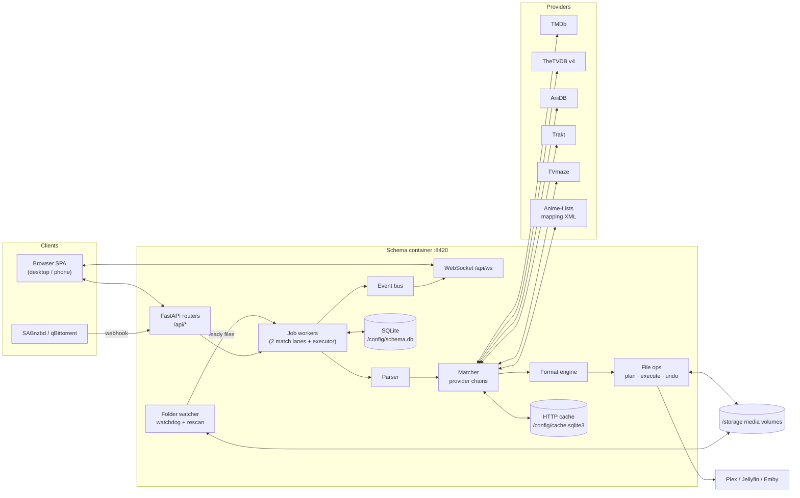
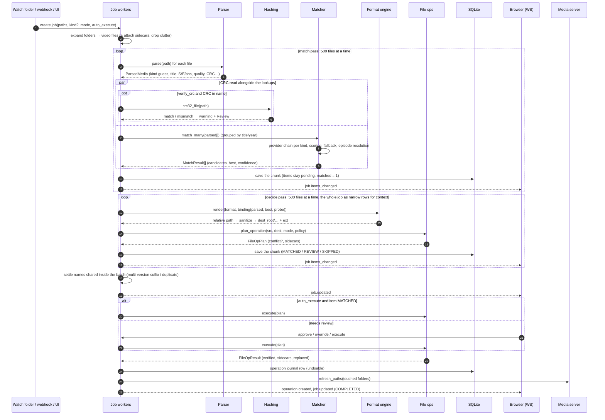

# Schema — Engineering Specification

> Web-native media organizer and renamer that replaces FileBot and the legacy
> `jlesage/filebot` noVNC container.

| | |
|---|---|
| Status | v1 build spec (Phase 0 complete) |
| Code | `backend/` (FastAPI, Python 3.12+), `frontend/` (React 18 + Vite + Tailwind), `deploy/` |
| Contracts | `backend/schema_app/domain.py`, `backend/schema_app/api_models.py`, interface stubs listed in §4.3 |

---

## 0. Goals and non-goals

**Goals**

1. Rename and sort movies, TV series and anime from metadata providers (TMDb, TheTVDB v4, AniDB, Trakt, TVmaze) with automatic fallback.
2. Run as a fast web app (desktop and phone) instead of a Java Swing desktop streamed over VNC.
3. Show a reviewable **preview before any file moves**: original → parsed → proposed path, with one-click overrides.
4. Automate: watch folders, SABnzbd/qBittorrent webhooks, Plex/Jellyfin/Emby refresh.
5. Be **safe**: atomic moves, conflict policies, sidecar handling, full undo journal, and root-boundary enforcement.
6. **Keep FileBot muscle memory:** format expressions use FileBot binding names and a safe subset of its expression syntax, so existing formats like `{n} - {s00e00} - {t}` or `{ny}/{'Season '+s}/{n} - {s00e00} - {t}` paste in and work.

**Non-goals for v1:** music and photo renaming, subtitle downloading, artwork/NFO writing, multi-user RBAC, and transcoding. These are tracked in Phase 5 (§13).

---

## 1. Code organization

The code is split into four areas with clear boundaries. Cross-area calls go through the contract files (`backend/schema_app/domain.py`, `backend/schema_app/api_models.py` and the interface stubs in §4.3).

### 1.1 Areas

| Area | Files | Depends on |
|---|---|---|
| **Systems** | `backend/schema_app/{__main__,main,config,db,models,auth,deps}.py`, `backend/schema_app/api/**`, `backend/schema_app/core/pipeline.py`, `backend/schema_app/core/format/**`, `backend/schema_app/services/{events,settings_store,jobs}.py`, `backend/schema_app/demo/**` (except `demo_files.txt`), `backend/tests/systems/**` | contracts, all stubs |
| **Metadata** | `backend/schema_app/core/parser/**`, `backend/schema_app/core/{matcher,scoring,normalize}.py`, `backend/schema_app/providers/**`, `backend/tests/metadata/**` | contracts, `demo/demo_files.txt` |
| **DevOps** | `backend/schema_app/services/{paths,fileops,watcher,hashing,probe,mediaservers,downloaders}.py`, `backend/tests/devops/**`, `Dockerfile`, `.dockerignore`, `docker-compose.yml`, `deploy/**`, `.github/**`, `scripts/dev.*`, `docs/DEPLOYMENT.md`, `docs/MIGRATION_FROM_FILEBOT.md` | contracts |
| **Frontend** | `frontend/**`, `scripts/brand.py` | contracts, `logo/` |

### 1.2 Conventions

1. **Contract first.** Every cross-area call goes through a signature already present in a contract or stub file (§4.3).
2. **Fakes in unit tests.** Unit tests replace sibling modules with fakes or monkeypatches. Tests that need the real sibling are marked `@pytest.mark.integration`.
3. **Definition of done:** module implemented, `ruff check` clean, its tests green.

---

## 2. Legacy audit and gap analysis

### 2.1 What runs today

The legacy setup is the **jlesage/filebot** image: FileBot's Java Swing desktop inside Xvfb, streamed by noVNC (title `FileBot`, `site.webmanifest` "Opens the graphical interface of FileBot running in a Docker container", built-in noVNC file manager and terminal modals). The image also runs FileBot's AMC script against a `/watch` → `/output` pair, with config in `/config` and media mounted at `/storage`.

### 2.2 FileBot features Schema keeps

* **Format expressions:** FileBot formats use bindings such as `n y s e sxe s00e00 t d absolute ny vf vc ac af source edition group fn ext crc32 …`. A `{…}` block whose binding is undefined renders as empty, which is how `{' - '+t}` acts as an optional segment. Schema keeps these semantics (§8).
* **Data sources:** TheTVDB, TMDb (movie + TV), AniDB, TVmaze, plus AnimeLists mapping data for anime cross-references (§6.4).
* **Rename actions:** move, copy, symlink, hardlink, test, with conflict policies and a history for revert (§7.2).
* **Post-processing:** library refresh for Plex, Jellyfin and Emby (§7.6).

**Design decisions:**

* Each top-level `{…}` block is isolated, and errors it swallows are **shown** in the preview and validator (§8.3).
* Default chains put `tmdb` first for series; anime puts `anidb` first only when configured (§6.2).
* The candidate similarity cut-off is tunable and starts at 0.72 on normalized titles (§6.3).
* Episodes are assigned one-to-one per batch inside `match_many` (§6.4). Leftovers go to **Review** instead of guessing.
* Parser confidence plus matcher kind-fallback classify movie / series / anime. Ambiguous files go to **Review**, not to failure.
* Every provider gets a per-host token bucket, and AniDB a ban latch (§6.2).
* `upgrade` conflicts use `QualityInfo.rank()`. Identical files count as `same_file`. Displaced files are moved to trash, never deleted (§7.2).
* Folder watching uses settle detection on size + mtime, partial-file filters and a rescan fallback for SMB/NFS (§7.3).
* Native targeted refresh for each media server (§7.6).
* No license gate; `test` mode is a first-class dry run.

### 2.3 Friction points → Schema answers

| # | Legacy friction | Root cause | Schema answer |
|---|---|---|---|
| 1 | Laggy VNC desktop, unusable on a phone | Swing UI over noVNC | Responsive SPA; virtualized tables; WebSocket live updates (§9) |
| 2 | No batch preview without the GUI; AMC is fire-and-forget | CLI script automation | Every job, including automated ones, produces a reviewable preview; low-confidence items stop in **Review** (§3.3) |
| 3 | Overrides are click-heavy (re-search, re-match, re-order) | Desktop workflow | Inline candidate picker, free-text search, per-item S/E/absolute override, bulk approve/skip (§9.3) |
| 4 | Multi-episode files, specials (`S00Exx`), absolute-vs-seasonal anime mismatches | Provider-order ambiguity | Explicit episode-order model, absolute ↔ seasonal conversion through provider absolute order + Anime-Lists mapping, title-based special matching (§6.4) |
| 5 | Groovy formats are powerful but unsafe and opaque when they fail | Arbitrary code eval | Sandboxed FileBot-compatible expression subset with positioned errors and live sample validation (§8) |
| 6 | Opaque provider failures | Single chain, log-only errors | Per-kind priority chains with recorded fallback reasons, health/test endpoints, rate-limit visibility (§6.2) |
| 7 | Webhook automation needs a custom AMC call per client | Script glue | Native `/api/webhooks/{sabnzbd,qbittorrent,generic}` with path mapping and category→kind hints (§7.7) |
| 8 | Media-server refresh means a full scan | Post-process scripts | Targeted refresh of only the touched folders (§7.6) |
| 9 | Undo is limited to the session history | Desktop history file | Persistent operation journal with per-operation undo (§7.2) |
| 10 | Licensing gate inside the container | Commercial license | Self-owned code; no license gate |

---

## 3. System architecture and data flow

### 3.1 Runtime topology

Schema ships as **one container and one process**: Uvicorn serves the FastAPI app, the built SPA and a WebSocket. Background work runs as asyncio tasks in the same process: the job workers, the folder watcher and media-server notifications. SQLite (WAL mode) holds state. There are no external services (no Redis, no Celery). That keeps it as easy to deploy as the FileBot container it replaces.

The job workers are two match lanes and one executor. Manual imports and watch-folder / webhook jobs match in separate lanes, so a library import of tens of thousands of files never holds up a new download. There is one executor: watch-folder and webhook runs go first, and they also run between two files of a long manual run. Long file work (CRC reads, probes, file operations) runs on a small thread pool of its own (5 threads). Short SQLite calls stay in the default pool.



### 3.2 End-to-end flow (ingest → relocation)



**Big jobs.** A job is matched in chunks of 500 files, and each chunk is saved before the next one is loaded. Memory stays flat, and every write transaction stays short (well under SQLite's 30 s `busy_timeout` even on a slow NAS disk), however big the job.
- The **match pass** parses, verifies CRCs, looks up and probes the files. Probes go through 3 workers, not one task per file. The pass then saves each chunk with the items still `pending` and `matched` set.
- The **decide pass** first skips bonus clips; that check needs every match first. It then renders, plans and decides each chunk. For context it reads the rest of the job as narrow rows: source path, status, proposed path, selected candidate and part. That context is what collisions, `di` / `dc` / `pc` and shared source folders need.
- **Collisions.** Two files of one batch can render to the same name. Those collisions are settled once every chunk is rendered. Only the items involved are planned and decided again.

Batches push one `job.items_changed` per saved chunk instead of one message per file (§5.1).

### 3.3 State machines

**Job:** `queued → matching → (review | ready) → executing → completed | failed`, with `cancelled` reachable from any non-terminal state. When `auto_execute` is set, MATCHED items execute right after matching. Leftover REVIEW items keep the job in `review`, and the job completes once nothing is left pending.

**Item:** `pending → matched | review | skipped`. Then `review → approved | skipped`, `matched/approved → executing → done | error`, and `done → (undo) → review`.

**Item rules** (applied in order):
1. Sample (`is_sample`) with `skip_samples`, or extra (`is_extra`) with `skip_extras` → `skipped` with a warning.
2. CRC present and `verify_crc` → mismatch adds warning `crc_mismatch` and forces `review`.
3. No best candidate, or `confidence < settings.min_confidence` → `review`.
4. Destination conflict under policy `skip` → `review` with warning `destination_exists`. Two items in one batch rendering to the same destination → multi-version suffix (§8.6), and `review` only if they still collide.
5. Otherwise → `matched`.

**Startup recovery:** jobs found in `matching` are re-queued in their lane. They resume from what was saved: items with `matched` set skip the match pass, and only the chunk that was in flight is looked up again. Items found in `executing` move to `review` with warning `interrupted`; the journal tells the user whether the file moved.

---

## 4. Tech stack and component blueprint

### 4.1 Stack

| Layer | Choice | Why |
|---|---|---|
| API | **FastAPI** + Uvicorn (Python 3.12+) | async I/O for provider fan-out, typed models shared with the domain, OpenAPI for free |
| Models | **Pydantic v2** | one schema for domain, API and settings |
| Persistence | **SQLAlchemy 2.0** (sync, threadpool) on **SQLite WAL** | zero-ops single container; Postgres-ready later |
| HTTP | **httpx** async + per-host token-bucket limiter + SQLite response cache | providers have strict limits (AniDB) |
| Fuzzy match | **rapidfuzz** | fast token-set/partial ratios |
| Transliteration | **Unidecode** | `ascii()` filter, query normalization |
| Watcher | **watchdog** + periodic rescan | inotify misses events on SMB/NFS |
| Probe | `mediainfo --Output=JSON` (fallback `ffprobe`) | quality facts beyond the filename |
| Auth | stdlib **scrypt** + itsdangerous signed cookie | no extra crypto dependencies |
| Frontend | **React 18 + TypeScript + Vite**, **Tailwind CSS**, **TanStack Query**, React Router, lucide-react, @tanstack/react-virtual | fast dev loop, typed client, virtualized tables |
| Fonts | Inter Variable + JetBrains Mono (self-hosted via @fontsource) | works offline on a LAN |
| Container | multi-stage Docker (node → python:3.12-slim), tini, PUID/PGID | drop-in for the jlesage container |

### 4.2 Repository layout

```
schema_media_renaming/
├── README.md
├── Dockerfile · docker-compose.yml · .dockerignore            (DevOps)
├── logo/ logo.jpg · logo_text.jpg                              (source brand assets)
├── scripts/ brand.py (Frontend) · dev.ps1 · dev.sh (DevOps)
├── docs/ SPEC.md · DEPLOYMENT.md · MIGRATION_FROM_FILEBOT.md · AUDIT-2026-10.md
├── deploy/ docker/entrypoint.sh · unraid/schema.xml · hooks/ (sabnzbd, qbittorrent)
├── backend/
│   ├── pyproject.toml
│   ├── schema_app/
│   │   ├── __main__.py            # `python -m schema_app` / `schema` → uvicorn
│   │   ├── main.py                # app factory, lifespan, SPA mount
│   │   ├── config.py              # env bootstrap (SCHEMA_*)
│   │   ├── db.py · models.py      # engine/session · ORM tables (§10)
│   │   ├── auth.py · deps.py      # session cookie, API key, dependencies
│   │   ├── domain.py              # ★ contract: core models
│   │   ├── api_models.py          # ★ contract: HTTP/WS bodies
│   │   ├── api/                   # routers: auth jobs items formats providers settings
│   │   │                          #          watch operations events fs webhooks dashboard ws demo
│   │   ├── core/
│   │   │   ├── parser/            # ★ parse(path) → ParsedMedia
│   │   │   ├── normalize.py · scoring.py
│   │   │   ├── matcher.py         # ★ Matcher, create_matcher
│   │   │   ├── format/            # engine (lexer/parser/evaluator) · bindings · presets · samples
│   │   │   └── pipeline.py        # job worker: ingest → parse → match → render → plan → execute
│   │   ├── providers/             # ★ base.py · http.py · cache.py · registry.py
│   │   │                          #   tmdb tvdb anidb trakt tvmaze fixtures animelists
│   │   ├── services/              # ★ paths fileops watcher hashing probe mediaservers downloaders
│   │   │                          #   events settings_store
│   │   └── demo/                  # demo_files.txt · library builder
│   └── tests/ conftest.py · systems/ · metadata/ · devops/
└── frontend/
    ├── index.html · vite.config.ts · tailwind.config.ts · package.json
    ├── public/brand/              # generated by scripts/brand.py
    └── src/ api/ components/ features/ lib/ styles/
```

★ marks a contract or stub file that already exists with the fixed signatures.

### 4.3 Cross-boundary interfaces (stubs already in the tree)

| Module | Signature | Owner | Caller |
|---|---|---|---|
| `core/parser` | `parse(path) -> ParsedMedia` | Metadata | Systems |
| `core/matcher` | `Matcher.match / match_many / search / resolve / provider_statuses / test_provider / reconfigure / aclose`; `create_matcher(settings, cache_dir=, demo=)` | Metadata | Systems |
| `providers/base` | `MetadataProvider` ABC + `ProviderError` family | Metadata | Metadata |
| `services/paths` | `sanitize_component`, `sanitize_relative_path`, `is_within` | DevOps | Systems (format engine), DevOps |
| `services/fileops` | `find_sidecars`, `plan_operation`, `execute`, `undo` | DevOps | Systems |
| `services/watcher` | `FolderWatcher(on_ready, on_status, …).start/stop/sync/status` | DevOps | Systems |
| `services/hashing` | `crc32_file`, `verify_crc32` | DevOps | Systems |
| `services/probe` | `available()`, `probe(path) -> ProbeInfo|None` | DevOps | Systems |
| `services/mediaservers` | `test_server(cfg)`, `refresh_paths(cfg, paths)` | DevOps | Systems |
| `services/downloaders` | `parse_webhook(source, payload, category_kinds=, path_mappings=) -> IngestRequest` | DevOps | Systems |

---

## 5. HTTP API

All routes live under `/api`. Bodies are the `api_models.py` types. Errors use the FastAPI form `{"detail": …}` with proper status codes (400 bad input, 401 unauthenticated, 403 forbidden path, 404, 409 state conflict, 422 validation). Lists take `limit` (default 50, max 500) and `offset`.

| Method | Path | Body → Response | Notes |
|---|---|---|---|
| GET | `/health` | → `{"status","version"}` | unauthenticated |
| GET | `/auth/status` | → `AuthStatus` | unauthenticated |
| POST | `/auth/setup` | `Credentials` → `AuthStatus` | only while `setup_required`; sets cookie |
| POST | `/auth/login` · `/auth/logout` | `Credentials` / – → `AuthStatus` | |
| GET | `/dashboard` | → `DashboardOut` | |
| GET | `/home` | → `HomeOut` | the Home flow board (§5.2); polled every few seconds, reused for up to 1 s while nothing changed |
| POST | `/home/actions` | `HomeActionIn` → `{"ok":true}` | a card's button: `key` + `skip` \| `approve` \| `retry` \| `dismiss` (§5.2); 404 unknown card, 409 wrong state |
| POST | `/home/refresh` | → `HomeRefreshOut` (`cleared`, `started`) | dismisses cards whose source file is gone from disk; starts finished files waiting in watch folders now |
| POST | `/home/dismiss-all` | → `HomeClearedOut` (`cleared`) | dismisses every Needs-review card (files are left alone) |
| GET | `/history` | `?filter&q&kind&before&limit` → `HistoryPage` | newest-first file timeline (§5.2); `limit` 1–200, default 50 |
| GET / POST | `/jobs` | `?status=` → `JobOut[]` / `JobCreate` → `JobOut` (202) | matching is async |
| GET / DELETE | `/jobs/{id}` | → `JobDetail` / 204 | one page of full items (`limit`, `after`, `status`, `q`, `view=slim`); delete refused while executing (409) |
| GET | `/jobs/{id}/items` | `?status&q&limit&offset&after&view` → `JobItemPage` | slim items by default; `q` matches source path, proposed path or parsed title (case-insensitive) |
| POST | `/jobs/{id}/execute` · `/cancel` · `/rematch` | `ExecuteRequest` / – / – → `JobOut` | |
| GET | `/items/{id}` | → `JobItemOut` | the full item: every stored candidate and the probe |
| PATCH | `/items/{id}` | `ItemUpdate` → `JobItemOut` | re-renders the path when the candidate changes |
| POST | `/items/{id}/rematch` | `ItemRematch` → `JobItemOut` | manual hint (kind, provider, show, S/E/abs, order) |
| POST | `/items/{id}/search` | `ItemSearch` → `Candidate[]` | |
| POST | `/items/bulk` | `BulkItemAction` → `JobItemOut[]` | by `item_ids` (full items; slim above 500), or by `job_id` + `statuses`/`q` (slim items; `[]` when more than 1000 matched: the client refetches on `job.items_changed`) |
| POST | `/preview` | `PreviewRequest` → `PreviewItem[]` | stateless; powers the format builder |
| POST | `/parse` | `{"names":[…]}` → `ParsedMedia[]` | |
| GET | `/search` | `?q&kind&year&provider` → `Candidate[]` | |
| GET / POST | `/formats` | → `FormatOut[]` / `FormatIn` → `FormatOut` | |
| PUT / DELETE | `/formats/{id}` | `FormatIn` → `FormatOut` / 204 | builtin presets are read-only (409) |
| GET | `/formats/catalog` | → `FormatCatalog` | bindings, methods, presets |
| POST | `/formats/validate` | `FormatValidateRequest` → `FormatValidateResponse` | live, debounced by the UI |
| GET | `/operations` | `?job_id` → `OperationOut[]` | |
| POST | `/operations/{id}/undo` | → `OperationOut` | |
| GET / POST | `/watch-folders` | → `WatchFolderOut[]` / `WatchFolderIn` → `WatchFolderOut` | path must be inside `allowed_roots` |
| PUT / DELETE | `/watch-folders/{id}` | | |
| POST | `/watch-folders/{id}/scan` | → `JobOut` | process existing files now |
| GET / PUT | `/settings` | `AppSettings` | secrets masked |
| GET / POST | `/settings/api-key` | → `{"api_key"}` | reveal / rotate webhook key |
| GET / PUT | `/providers` | `ProvidersIn` → `ProvidersOut` | |
| POST | `/providers/{name}/test` | → `ProviderStatus` | |
| POST | `/mediaservers/test` | `MediaServerConfig` → `MediaServerTest` | |
| GET | `/events` | `?level&category&job_id` → `EventOut[]` | |
| GET | `/fs/list` | `?path` → `FsListing` | confined to `allowed_roots` (403 outside) |
| POST | `/webhooks/{source}` | JSON or form → `WebhookAccepted` | `X-Api-Key` header or `?apikey=`; no cookie |
| POST | `/demo/reset` | → `{"ok":true}` | demo mode only |
| WS | `/ws` | server → `WsMessage` | cookie-authenticated; first message `hello` (§5.1) |

The SPA is served at `/` with history-API fallback to `index.html` for every non-`/api` path. Static brand assets live under `/brand/*`.

**Slim and full items.** The slim `JobItemOut` (`slim: true`) is what list pages, `item.updated` pushes and big bulk answers carry. It is built from the `job_items` row alone:
- `candidates` holds at most the selected candidate (else the best suggestion), stripped of overview, aliases, genres, ids and reasons.
- `candidate_count` gives how many are stored.
- `probe` is `null`.

The full form reads `job_item_candidates` too (§10).

### 5.1 WebSocket messages

`WsMessage` is `{"type", "data"}`. Each client has a queue of 1000 messages. When a slow client's queue overflows, its backlog is dropped and it gets `resync` instead.

| `type` | `data` | Sent when |
|---|---|---|
| `hello` | `{"version"}` | the socket opens |
| `job.updated` | `JobOut` | a job's status, progress or counts change |
| `job.deleted` | `{"id"}` | a job was deleted |
| `job.items_changed` | `{"job_id": int, "item_ids": [int, …]}` | a batch of one job's items changed: a saved match chunk, a bulk action, a bulk rematch, bonus clips skipped. Refetch those items. `item_ids` is left out when more than 1000 changed, which means "refetch the job's items on screen". |
| `item.updated` | slim `JobItemOut` | one item changed (edit, rematch, executing / done, undo) |
| `operation.created` · `operation.updated` | `OperationOut` | a journal row was written / changed (undone) |
| `event` | `EventOut` | a log event was recorded |
| `watcher.updated` | `WatchFolderOut` | a watch folder's state changed |
| `provider.updated` | `ProviderStatus` | a provider's health changed |
| `resync` | `{}` | messages were dropped for this client: refetch what is on screen |

Batches never push one message per file: a 50 000-file match sends about 200 `job.items_changed` messages (two passes of 100 chunks), not 50 000 `item.updated`.

### 5.2 Home and History

**`GET /home`** returns the board in one response:
- `needs_you`: up to 50 cards, newest first.
- `needs_you_count`.
- `incoming`: files settling or still downloading in watch folders, with a title guess.
- `renaming`: up to 20 items of running jobs, executing first.
- `library`: totals and the 6 latest moves.
- `status`: watch folders, providers and media servers.

**Needs-review cards** come in three kinds, each with a `key`:
- `item:<id>`: an item in `review` or `error`, unless it was dismissed, undone, or replaced by a newer item for the same file.
- `event:<id>`: an error event that no item card covers.
- `group:<job_id>`: five or more files of one job that vanished from their source before the rename, folded into one card.

When a newer copy of a file was moved or skipped, its old card shows as *solved*: it stays visible but isn't counted, and it clears after `clear_solved_after_hours`. Stale error events clear after the same time.

**`POST /home/actions`** runs a card's button:

| Action | Applies to | What it does |
|---|---|---|
| `dismiss` | any card | hides the card; for a group, every vanished-file card of that job |
| `skip` | item in `review`, `error`, `matched` or `approved` | sets the item to `skipped` |
| `approve` | item in `review`, `matched` or `approved` | approves the item and executes it |
| `retry` | item in `error` or `review` | matches the file again if it has no usable match (or the match itself failed), then executes it when the result is runnable; otherwise approves and executes it |

Group and event cards only accept `dismiss`.

**`GET /history`** merges two sources, newest first:
- the operation journal: moved, undone, failed and undo-failed moves; dry runs are left out;
- items that ended `skipped` or in `error`.

A failed move whose item is still in `error` shows once, as the item.

| `filter` | Shows |
|---|---|
| `all` | every entry |
| `moved` | completed moves (including undo-failed) |
| `skipped` | skipped items |
| `problems` | failed moves and items in `error` |

- `q` matches the source or destination path, or the item's parsed title (case-insensitive).
- `kind` (`movie` \| `series` \| `anime`) matches the item's card kind.
- Paging is keyset-based, so "Show older" stays stable while new entries arrive: pass the page's `next_before` back as `before`. It is `null` on the last page.

---

## 6. Metadata engine

### 6.1 Parser and normalization

`parse(path)` is pure: no I/O, under 1 ms per file. Processing stages:

1. **Split context:** filename stem, extension, parent folder, grandparent folder. Season folders (`Season 2`, `S02`, `Specials`, `Season 00`) supply season and series context. Movie folders (`Title (Year)`) supply title and year. Disk folders (`VIDEO_TS`, `BDMV`) climb one level.
2. **Tokenize** on `. _ - [ ] ( ) {}` and whitespace, keeping bracket groups as units. A leading `[Group]` marks a fansub release group (anime signal).
3. **Strip and record tags** into `QualityInfo`: resolution (`2160p/4K/UHD`), source (BluRay/BDRip/BRRip → BluRay; WEB-DL/WEBRip/HDTV/DVDRip/DVD), `REMUX`, codecs (x264/H.264/AVC; x265/H.265/HEVC; AV1; XviD; VC-1), bit depth (`10bit`, `Hi10P`), HDR (`HDR`, `HDR10`, `HDR10+`, `DV`/`DoVi`/`Dolby Vision`, `HLG`), audio (AAC, AC3/DD, DDP/EAC3, TrueHD, DTS, DTS-HD MA, DTS-X, FLAC, Opus) plus channels (`5.1`, `7.1`, `DDP5.1`) and `Atmos`, streaming service (AMZN, NF, DSNP, HMAX, ATVP, HULU, PCOK…), `PROPER/REPACK/RERIP`, 3D (`SBS/TAB/OU`), languages (`MULTi`, `GERMAN`, `VOSTFR`…), edition (Director's Cut, Extended, Theatrical, Ultimate, Unrated, Uncut, Remastered, IMAX, Open Matte, Anniversary Edition…), release group (trailing `-GROUP` or leading `[Group]`), CRC (`[A1B2C3D4]`), and version (`07v2`).
4. **Numbering patterns** (most specific first): `S01E02E03`, `S01E02-E03`, `S01E02-03` (range), `S01.E02`, `1x02(-1x03)`, `Season 1 Episode 2`, `102`/`0102` (only with season context and no year collision), daily `2024.03.04` / `2024-03-04`, anime absolute ` - 015 `, `E15`, `#15`, `EP15`, `第15話`, specials (`S00E01`, `OVA`, `OAD`, `ONA`, `SP1`, `Special`), and movie parts (`CD1`, `Part 2`, `pt2`, `Disc 1`).
5. **Title:** the text before the first numbering or tag token, de-dotted, with release-group and website prefixes stripped (`www.site.org -`). Year: a 1900–2099 token not belonging to a resolution or daily date; the last plausible year wins for movies (`2001 A Space Odyssey 1968`).
6. **Kind guess:** episode pattern → `series`; anime signals (leading `[Group]`, CRC, bare absolute number, known fansub group, `v2`) → `anime`; title + year and no episode → `movie`; else `unknown`. `confidence` reflects pattern strength.
7. **Clutter:** `is_sample` (`sample` token, `-sample.`, or a Sample folder), `is_extra` (trailer, featurette, behind the scenes, deleted scenes, interview, NCOP/NCED/OP/ED creditless, Extras/Featurettes folders).

`normalize.py` holds the shared normalization for matching: lowercase, Unidecode, `&`→`and`, strip punctuation and leading articles for comparison only, roman ↔ arabic numerals (`II`↔`2`), and collapse whitespace.

### 6.2 Providers, HTTP layer and fallback

| Provider | Kinds | Auth | Endpoints (base) | Our limiter | Notes |
|---|---|---|---|---|---|
| `tmdb` | movie, series, anime | v3 `api_key` or v4 Bearer | `api.themoviedb.org/3`: `search/movie`, `search/tv`, `movie/{id}?append_to_response=external_ids,alternative_titles,release_dates`, `tv/{id}?append_to_response=external_ids,alternative_titles`, `tv/{id}/season/{n}`, `tv/{id}/episode_groups` | 20 req/s | absolute = cumulative over seasons ≥1 |
| `tvdb` | series, anime, movie | v4 `/login` (apikey [+pin]) → bearer (cache 25 days) | `api4.thetvdb.com/v4`: `search?type=series`, `series/{id}/extended`, `series/{id}/episodes/{default\|dvd\|absolute}`, `series/{id}/translations/{lang}` | 10 req/s | native absolute order |
| `anidb` | anime | registered client + clientver | `api.anidb.net:9001/httpapi?request=anime&aid=` (XML, gzip); titles dump `anidb.net/api/anime-titles.xml.gz` | **≤ 5 req / 60 s and ≤ 200 / 24 h** (FileBot's own limits), **ban latch**: a `banned` response halts AniDB for 24 h; titles dump ≤ 1/day; 7-day cache | bans on abuse; local fuzzy title index |
| `trakt` | movie, series | `trakt-api-key` header, `trakt-api-version: 2` | `api.trakt.tv`: `search/movie,show`, `shows/{id}/seasons?extended=episodes,full`, `movies/{id}?extended=full` | 3 req/s | carries tmdb/tvdb/imdb ids |
| `tvmaze` | series | none | `api.tvmaze.com`: `search/shows`, `shows/{id}`, `shows/{id}/episodes?specials=1`, `shows/{id}/akas` | 2 req/s (20 / 10 s) | keyless fallback |
| `fixtures` | all | none | in-package JSON | – | demo mode and tests (§6.5) |
| `animelists` (helper) | – | none | Anime-Lists `anime-list-master.xml` (GitHub raw) | ≤ 1/day | AniDB ↔ TVDB/TMDb season + offset mapping |

* **`providers/http.py`:** one shared `httpx.AsyncClient` per provider with timeouts (connect 5 s, read 20 s), a per-host token-bucket limiter, retries with jittered exponential backoff on 429/5xx/timeouts (honoring `Retry-After`), and a `User-Agent: Schema/<version>`.
* **`providers/cache.py`:** a stdlib `sqlite3` key/value cache at `<data_dir>/cache.sqlite3` with per-entry TTL (search 24 h, details 7 d, episodes 24 h, AniDB 7 d, titles dump 24 h), plus an in-memory LRU on top. Counts hits for `ProviderStatus.cache_hits`.
* **`providers/registry.py`:** builds providers from `ProviderSettings`, exposes `chain(kind)` filtered by configured, enabled and priority order. In demo mode `fixtures` is prepended.

**Fallback algorithm (per item group):**

1. If `hint.ref` is set, resolve directly with that provider.
2. Walk `chain(kind)`. For kind `unknown`: if episode numbering is present, use the series chain; else try movie then series and keep the better result.
3. Per provider: call search with `title`, then `alt_titles`/`folder_title`. Retry without year if nothing comes back. On `ProviderNotConfigured` skip silently (recorded); on other `ProviderError` record it in `provider_errors` and continue.
4. Score candidates (§6.3). For episodic kinds, resolve episodes. A candidate whose episodes can't be resolved is penalized but kept.
5. **Stop** at the first provider whose best candidate reaches `score ≥ 0.85` **and** has resolved episodes (or is a movie). Otherwise accumulate and continue, then merge across providers. Dedupe by shared external ids (tvdb/tmdb/imdb) and keep the richer record.
6. **Episode-level fallback:** if the chosen series is found but an episode (often a special) is missing at that provider, ask the next provider that knows the same series (via `ids`) for just that episode.

### 6.3 Scoring

`scoring.py` produces a 0–1 score per candidate with human-readable `reasons`:

| Signal | Weight / rule |
|---|---|
| Title similarity | max over (title, original title, aliases) of max(ratio, token-sort ratio, ½ token-set + ½ token-sort) on normalized strings; weight **0.70**. Plain `token_set_ratio` scores a subset decoy ("Starfall" vs "Starfall Station") at 100 %. Candidate cut-off 0.72, at most 5 results per query |
| Year | exact +0.20; ±1 +0.10; mismatch > 1 −0.25; unknown year 0 |
| Episode existence | requested S/E (or absolute or air date) exists: +0.15; missing: −0.30 |
| Kind agreement | kind matches +0.05; anime-flagged series for anime files another +0.05; movie/series mismatch −0.20 |
| Popularity | tiebreak only (≤ +0.03, log-scaled) |
| Season-count plausibility | file season > series season count → −0.20 (this is what resolves "Harbor Lights S02E05" to the 2008 series) |

`MatchResult.confidence` = best score, minus a 0.10 ambiguity penalty when the runner-up is within 0.05.

### 6.4 TV, specials and anime logic

* **Multi-episode:** `episodes=[2,3]` resolve to two `EpisodeInfo`. Bindings render `S01E02-E03` and join titles with `&`. Identical titles that differ only by `(1)`/`(2)` or `Part 1/2` collapse to `Title (1-2)`.
* **Specials:** numbered (`S00E02`) map directly to season 0. Un-numbered specials (`special_title`, OVA) are matched by fuzzy title against season-0 episodes (threshold 0.80). A lone `OVA` with a single season-0 episode maps to it.
* **Daily shows:** match by `air_date` across all episodes.
* **Absolute → seasonal:** (a) if the provider has absolute order (TVDB `absolute`, fixtures), map directly; (b) else compute absolute as the cumulative count over regular seasons in aired order; (c) for AniDB entries (one AniDB id per season/cour) use the Anime-Lists mapping (`defaulttvdbseason`, `episodeoffset`, explicit `mapping-list`) to translate to TVDB seasonal numbering. If an absolute number exceeds a single AniDB entry, walk Anime-Lists siblings that share the same TVDB id. The reverse (seasonal → absolute) fills `{absolute}`.
* **Multi-version movies:** identical identity with different `QualityInfo` → same folder; filenames get a version suffix (§8.6). `UPGRADE` policy compares `QualityInfo.rank()`.
* **Editions:** `edition` flows to bindings (`{edition}` and Plex `{edition-…}` tag in presets).

### 6.5 Demo fixtures

`providers/fixtures.py` + `fixtures_data.json` hold a fictional catalogue designed against `demo/demo_files.txt`. Every demo file must resolve as its comment says.

* **Series:** *Starfall Station* (2016; S1–S3 × 10; S00E01 "The Making of Starfall", S00E02 "Christmas Special", S03E03 "Ghosts in the Array"; ids tvdb 900001 / tmdb 800001 / imdb tt9000001) · decoy *Starfall* (1998, 1 season) · *Harbor Lights* (2008; S1, S2 × 8) · *Harbor Lights* (2021; S1 × 6) · *The Late Hour with Sam Reyes* (2019; daily, season 2024 eps 1–5 aired 2024-03-01 … 03-05).
* **Anime:** *Kaze no Tsubasa* (2018; aliases "Wings of the Wind", "風の翼"; is_anime; S1 12 eps abs 1–12, S2 13 eps abs 13–25, S3 12 eps abs 26–37; S00E01 OVA; ids anidb 90001 / tvdb 900101) · *Tensei Robo Gaiden* (2020; S1 × 24).
* **Movies:** *The Quiet Meridian* (2019) · decoy *The Quiet Meridian Returns* (2022) · *Iron Orchard* (1987) and (2023) · *Paper Moons* (2004) · *Neon Requiem* (2021). Fake tmdb ids 700001–700006.
* Episode titles are invented and plausible. The provider honors `language` (English only is fine).

---

## 7. Pipeline services and deployment

### 7.1 Paths
Windows-safe component sanitization everywhere (Schema runs on Linux but writes to SMB shares and must round-trip on Windows clients). Default `:` → ` - `. A 255-byte component limit preserves extensions and sidecar suffixes. `is_within` resolves symlinks and is case-insensitive on Windows.

### 7.2 File operations and undo
* **Modes:** `move` (same device: `os.replace`; cross-device: copy to `.<name>.schema-tmp` in the destination dir, fsync, verify size, rename, then delete source), `copy` (temp + verify + rename), `hardlink` (fails cleanly cross-device with a clear error), `symlink` (absolute target), `keeplink` (move, then symlink back to the original location), `test` (no-op validation).
* **Conflicts:** `skip`, `overwrite`, `upgrade` (replace only when incoming rank > existing), `index` (` (1)`, ` (2)`…), `fail`. Case-only renames on case-insensitive filesystems go through an intermediate name. Same-file (hardlink or identical inode) counts as already done.
* **Sidecars:** files with the same stem plus language/flag suffixes (`.en.srt`, `.eng.forced.ass`, `.idx/.sub` pairs, `.nfo`) follow the video and keep their suffixes.
* **Folders renamed in place** (`move` only, `rename_folders_in_place`, on by default): when a movie already sits in its own folder, that folder is renamed (`/media/movies/Alien.1979` → `/media/movies/Alien (1979)`, one same-filesystem `rename`), then the file and its sidecars are renamed inside it; posters and extras stay with it. All of these must hold, otherwise it is a plain move: the old and new folder have the same parent; the source is the only video in its folder, sub-folders included (videos in extras folders such as `extras`, `featurettes`, `trailers`, `sample` don't count), so a collection is never renamed; no other item of the same job has its source in the folder (directly, whatever its status, or in a sub-folder unless skipped); nothing exists at the new folder name yet; the folder is not protected (below). If the rename itself fails, the file is moved instead. Previews (`JobItemOut.folder_rename`) and dry runs show it; undo renames the file back first, then the folder.
* **Empty source folders** (`move` only, `remove_empty_source_folders`, on by default): after a plain move, the source folder is removed if it is now completely empty, then each empty parent, stopping at the first protected folder. Protected: allowed roots, library roots, the job's destination root, watch folders, path-mapping targets, every folder holding one of these, and share-level folders (direct children of a root that holds another root, e.g. `/media/downloads` beside `/media/movies` in `/media`). Removed folders are listed in `FileOpResult.removed_dirs`; undo recreates them.
* **Safety:** source and destination must be inside `allowed_roots`. Free-space check before copy. Displaced files go to `<data_dir>/trash/<date>/…` (never hard-deleted by Schema). Every result carries the information needed to undo it.
* **Undo:** reverse the move or remove the copy/link, then restore displaced files from trash. Refused if the destination's size/mtime changed since.

### 7.3 Watcher
`watchdog` observers per folder plus a periodic full rescan (default 60 s) for network mounts. A file is ready when size and mtime have been unchanged for `settle_seconds`, it is not open for writing (best effort: attempt exclusive open on Windows; on Linux size stability is enough), and it does not match `ignore_patterns`. Ready files are batched per folder (≤ 2 s window) into one `on_ready` call so season packs become one job. Missing folders report `missing` and are retried.

### 7.4 Hashing
Streaming CRC32 (`zlib.crc32`, 4 MiB chunks) is used to verify `[ABCD1234]` names before matching. The service is shared with future SFV/MD5 verification.

### 7.5 Probe
`mediainfo --Output=JSON` (fallback `ffprobe -show_streams -show_format -of json`) with a timeout, mapped to `ProbeInfo`. The probe is optional: everything works from filenames alone. Docker installs `mediainfo`.

### 7.6 Media servers
* **Plex:** `GET /library/sections` (X-Plex-Token) to find the section whose location contains the mapped folder, then `GET /library/sections/{key}/refresh?path=<folder>`.
* **Jellyfin/Emby:** `POST /Library/Media/Updated` with `{"Updates":[{"Path": folder, "UpdateType":"Created"}]}` (header `X-Emby-Token`), falling back to `POST /Library/Refresh`.

Refreshes are debounced per server (5 s) and de-duplicated by folder. A folder that no longer exists (renamed in place, or removed when empty) is refreshed through its parent, so the server drops the stale entry.

### 7.7 Download-client webhooks
* **SABnzbd:** the bundled post-processing script `deploy/hooks/sabnzbd/schema_notify.py` reads `SAB_COMPLETE_DIR`, `SAB_FINAL_NAME`, `SAB_CAT`, `SAB_PP_STATUS` and POSTs JSON. Failed downloads (status ≠ 0) are ignored.
* **qBittorrent:** "Run external program on torrent finished" → `curl` form-POST of `%F` (content path), `%N`, `%L` (category), `%I` (hash).
* **Generic:** `{"path"|"paths", "kind"?, "category"?}`.

Path mappings translate client-side paths (e.g. `/downloads`) to Schema paths (`/storage/downloads`). Category → kind via `settings.category_kinds`.

### 7.8 Container and deployment
* Multi-stage `Dockerfile`: node:22 builds `frontend/dist`; python:3.12-slim runtime with `mediainfo`, `tini` and `gosu`. Non-root via `PUID`/`PGID` (aliases `USER_ID`/`GROUP_ID` for jlesage parity) and `UMASK`, `TZ`.
* Volumes mirror the legacy container: `/config` (DB, cache, trash, secret key), `/storage` (media), optional `/watch` and `/output`. Port `8420`.
* `HEALTHCHECK` hits `/api/health`.
* Also shipped: `docker-compose.yml`, an Unraid template (`deploy/unraid/schema.xml`), `.github/workflows/ci.yml` (pytest, frontend build, docker build), and `docs/DEPLOYMENT.md` + `docs/MIGRATION_FROM_FILEBOT.md` (volume mapping, format conversion table, AMC option equivalents, running side-by-side on `:8420` during shadow mode).

---

## 8. Format language

### 8.1 Template structure
A format is literal text with `{…}` expression blocks. Literal `/` creates folders. `{{` and `}}` emit literal braces. The rendered string is relative to the library root, and the source extension (plus sidecar suffix) is appended automatically. After rendering, each **binding value** passes through `sanitize_component` (so a `/` in a title never creates a folder), and the whole result passes through `sanitize_relative_path`.

### 8.2 Expressions (safe FileBot-compatible subset)
Expressions are parsed by our own Pratt parser and evaluated by a tree-walking interpreter. **No `eval`, no Python attribute access, no imports.**

```
expr       := ternary
ternary    := elvis ('?' expr ':' expr)?
elvis      := or ('?:' or)*
or         := and ('||' and)*            and := equality ('&&' equality)*
equality   := compare (('=='|'!=') compare)*
compare    := sum (('<'|'<='|'>'|'>=') sum)*
sum        := product (('+'|'-') product)*
product    := unary (('*'|'%') unary)*
unary      := ('!'|'-') unary | postfix
postfix    := primary ( '.' IDENT ('(' args? ')')? | '[' expr ']' )*
primary    := STRING | NUMBER | true | false | null | IDENT | '(' expr ')'
            | '[' (expr (',' expr)*)? ']' | ('any'|'allOf') ('{' expr '}')+
```
Strings use `'…'` or `"…"` with `\` escapes. Identifiers resolve to bindings (§8.3). Dotted access works only on Schema binding objects (`episode.special`, `plex.id`, `info.network`) and on whitelisted properties.

### 8.3 Semantics
* **Undefined binding** (e.g. `{t}` for a movie, `{edition}` when none) raises `BindingMissing`. A block that raises renders `""`, so `{' - ' + t}` is an optional segment.
* Groovy truthiness: null, `""`, `0` and empty list are false. `a ?: b` returns `a` when truthy, else `b`. `any{a}{b}` is the first closure that evaluates without error to a non-empty value. `allOf{a}{b}` is the list of all that do.
* `+`: string concatenation if either side is a string, else numeric add. Lists render as `[a, b]`, dropping null/missing entries; an empty list renders `""`.
* Errors other than missing bindings (unknown method, wrong arity, type errors) are **validation errors** with character offsets, surfaced by `/formats/validate`.
* Evaluation budget: max 10 000 steps per render (guards against pathological expressions).

### 8.4 Methods (whitelist; names follow FileBot)
| Method | Meaning |
|---|---|
| `pad(n)` | zero-pad a number (`{e.pad(3)}` → `007`) |
| `lower()` `upper()` `upperInitial()` `lowerTrail()` `capitalize()` | case helpers (`upperInitial`: first letter of each word upper) |
| `colon(r)` `slash(r)` `space(r)` | replace `:` / path separators / whitespace runs with `r` |
| `replace(a,b)` `replaceAll(re,b)` `removeAll(re)` `remove(s…)` | literal / regex replace (regex with timeout guard) |
| `before(s)` `after(s)` `match(re)` | substring helpers (`match` returns group 1 or whole match; missing → BindingMissing) |
| `ascii()` `acronym()` `sortName()` `sortInitial()` `trim()` `take(n)` | transliteration, "Office, The", first letter (`#` for non-letters) |
| `replaceTrailingBrackets()` `removeIllegalCharacters()` | clean-ups |
| `join(sep)` `first()` `last()` `sort()` `size()` `contains(x)` `startsWith(x)` `endsWith(x)` `isEmpty()` | lists and strings |
| `format(pattern)` | dates, Java-style patterns `yyyy-MM-dd` mapped to strftime |
| `toInteger()` `toString()` | conversions |

FileBot methods that Schema lacks are reported by the validator as *unsupported* (not as syntax errors).

### 8.5 Bindings (v1)
FileBot names unless marked *(Schema)*.

| Group | Bindings |
|---|---|
| Naming | `n` (series/movie name), `y`, `ny` ("Name (Year)"), `primaryTitle`, `alias` (list), `az` (sort initial), `decade` |
| Episode | `s` `e` `es` `sxe` `s00e00` `s00` `e00` `absolute` `t` `d`/`airdate` (date) `startdate` `special` (bool) `episode` (object: `.season .episode .absolute .title .special .airdate`) `regular` |
| Movie | `collection` `pi` (part index) `pc` (part count) |
| Info | `type` ("Movie"/"Episode") `anime` (bool) `genre` `genres` `language` `country` `runtime` `certification` `rating` `info` (object: `.network .status .overview`) |
| IDs | `id` `tmdbid` `tvdbid` `imdbid` `anidbid` *(Schema)* `provider` *(Schema)* |
| Quality | `vf` (1080p) `vc` (x264) `ac` (DDP) `af`/`channels` (5.1) `aco` ("DDP 5.1 Atmos") `hdr` (HDR10/DV) `dovi` (bool) `bitdepth` `resolution` (1920x1080, probe) `width` `height` `fps` `source` `edition` `tags` (list) `s3d` `group` `remux` *(Schema)* `version` *(Schema, anime v2)* |
| File | `fn` (original name w/o ext) `ext` `f` (source path) `folder` `crc32` `lang` (sidecar language) `subt` (sidecar suffix e.g. `.eng.forced`) `bytes` `duration` |
| Presets | `plex` `plex.id` `plex.name` `jellyfin` `jellyfin.id` `emby` `emby.id` `kodi`: full standard relative paths **without** the top-level library folder (Schema's library roots replace FileBot's `Movies/`/`TV Shows/`) |

Preset shapes:
* Plex movie `{ny}/{ny}` (`.id` adds ` {tmdb-ID}` to both).
* Plex series `{n} ({y})/Season {s.pad(2)}/{n} ({y}) - {s00e00} - {t}`, using `Specials` for season 0 (`.id` adds ` {tvdb-ID}` to the folder).
* Jellyfin: same, with ` [tmdbid-ID]`/` [tvdbid-ID]` and `Season 00` for specials.
* Emby uses `[tmdbid=ID]`.
* Kodi uses ` {tmdb=ID}` and unpadded `Season {s}`.

### 8.6 Defaults, presets and multi-version
Seeded formats (editable copies; builtins read-only):
* movie: `{ny}/{ny}{' - ' + edition}{' - pt' + pi}`
* series: `{n} ({y})/{special ? 'Specials' : 'Season ' + s.pad(2)}/{n} - {s00e00}{' - ' + t}`
* anime: `{n}/{special ? 'Specials' : 'Season ' + s.pad(2)}/{n} - {s00e00}{' - ' + t}`
* Presets: Plex, Plex+IDs, Jellyfin, Emby, Kodi for each kind, plus "Anime absolute" `{n}/{n} - {any{absolute.pad(3)}{s00e00}}{' - ' + t}`.

When two items in one batch render to the same destination, append ` - {vf}` plus ` Remux` / ` HDR` as needed (Plex multi-version convention). If they still collide, fall back to the conflict policy.

### 8.7 Validation samples
`core/format/samples.py` provides fixed synthetic bindings per kind (no network): a multi-episode, a special, an anime absolute file, a movie with edition, a multi-part movie, and a movie with no year. `/formats/validate` renders each and reports per-sample output or error.

---

## 9. Frontend

### 9.1 Design system
* **Theme:** dark-first, derived from the logo. Tokens (Tailwind `theme.extend.colors`):
  * Surfaces: `ink-950 #0F1216` (app bg), `ink-900 #15181D` (surface), `ink-850 #1B1F25` (raised), `ink-800 #262B33` (border).
  * Text: `ice-100 #D6EDF3` (primary), `slate-400 #8B95A3` (muted).
  * Brand: `brand-cyan #0CE7FA`, `brand-sky #1DC6EF`, `brand-azure #4998D1`, `brand-indigo #6456C5`, `brand-violet #7A33B3`; gradient `linear-gradient(135deg, #0CE7FA, #4998D1 45%, #7A33B3)` for brand moments only (logo halo, primary CTA, progress).
  * Status: success `#34D399`, warning `#FBBF24`, danger `#F87171`, info `#60A5FA`. Confidence meter: < 0.60 danger, < 0.85 warning, ≥ 0.85 success.
  * A light theme exists (toggle; respects `prefers-color-scheme`).
* **Type:** Inter Variable (UI), JetBrains Mono (paths, expressions, filenames).
* **Density:** compact 32 px rows in tables, 8 px grid, 12–14 px body.
* **Accessibility:** WCAG AA contrast, full keyboard support (`j/k` row navigation, `a` approve, `s` skip, `/` search, `Enter` open inspector, `⌘/Ctrl+Enter` execute), visible focus rings in `brand-sky`, and `prefers-reduced-motion` respected.

### 9.2 App shell and routes
Left sidebar (collapsible; bottom tab bar on phones) holding the logo mark and wordmark, the live queue badge and a WebSocket connection dot.

| Route | Page |
|---|---|
| `/setup`, `/login` | full-bleed brand lockup (`logo_text`), first-run admin creation / sign-in |
| `/` | **Dashboard**: queue stat cards, active jobs with progress, live activity feed, recent file movements (with undo), error log, watcher and provider health |
| `/import` | new job: server file browser (`/fs/list`), paste paths, kind/mode/format/destination options |
| `/jobs`, `/jobs/:id` | queue list → **Match workspace** (§9.3) |
| `/formats` | **Format builder** (§9.4) |
| `/watch` | watch folders CRUD + status + "scan now" |
| `/history` | operation journal with filters and undo |
| `/activity` | event log (level/category filters, live tail) |
| `/settings` | tabs: General · Providers (keys, drag-ordered priority per kind, test) · Media servers · Automation (API key, copy-paste SAB/qBit snippets, path mappings, category map) · About |

**Splash:** on cold load, while `/auth/status` resolves, show the centered mark on `ink-950` with a soft gradient glow (fade in/out, ≥ 400 ms, skipped under reduced motion).

### 9.3 Match workspace (split pane)
* **Left/main:** a virtualized table, one row per file, with three aligned columns **Original filename → Parsed metadata → Proposed path**. The parsed column shows chips (kind, S/E or abs, year, vf, source, group, CRC ✓/✗). The proposed path is mono, folder segments dimmed and the changed part highlighted. A status pill and confidence meter sit per row. Filter tabs: All / Needs review / Matched / Skipped / Done / Errors. Multi-select with bulk approve, skip and rematch.
* **Right: inspector** for the selected item:
  * ranked candidates (poster, title, year, provider badge, score, reasons);
  * a "search instead" box (query, year, kind, provider);
  * override controls (kind; season/episode or absolute; episode order aired/dvd/absolute);
  * an editable destination path with reset;
  * warnings;
  * sidecars that will travel.
* **Top bar:** job summary, mode selector (move/copy/hardlink/symlink/keeplink/test), conflict-policy hint, and an **Execute** button showing a count ("Rename 18 files"). Changes stream in over WebSocket; optimistic updates on PATCH.

### 9.4 Format builder
* A monospace expression editor with syntax highlighting (blocks, strings, bindings, methods) and squiggles from `issues`.
* A binding palette grouped as in §8.5: click to insert, hover to see description and example.
* Method chips, preset gallery, and a kind switcher.
* A **live preview** table showing samples' rendered output (debounced 250 ms `/formats/validate`), plus a "try with your files" input that calls `/preview`.
* Save as named format, set default per kind, and an import box that accepts FileBot formats verbatim and reports unsupported bits.

### 9.5 Brand pipeline
`scripts/brand.py` (Pillow, deterministic, re-runnable; `npm run brand`) reads `logo/logo.jpg` and `logo/logo_text.jpg`.

* `logo.jpg` has a **baked-in checkerboard** (not real transparency). Key it out by chroma: background pixels are near-neutral grey while the mark is saturated cyan→violet. Alpha comes from chroma with soft edges and color de-fringing, then the result is trimmed.
* `logo_text.jpg` is the lockup on a dark gradient.

Outputs in `frontend/public/brand/`:
* `mark-{512,192,32}.png` (web manifest, README, `index.html`);
* `favicon.ico` (16/32/48);
* `apple-touch-icon.png` (180, mark on `#15181D`);
* `og-image.png` (1200×630);
* `site.webmanifest` (theme/background `#15181D`).

The images the app draws are bundled from `frontend/src/assets/brand/` as WebP at twice their on-screen size: `mark-{72,112,224}.webp` (header, empty states, splash), `wordmark[-ink]-520.webp` (lockup with the background removed; login/setup) and `wordtype[-ink]-48.webp` (header).

---

## 10. Data model (SQLite via SQLAlchemy)

| Table | Columns (key ones) |
|---|---|
| `users` | id, username (unique), password_hash (scrypt `n=2^14,r=8,p=1` + salt), created_at, last_login_at |
| `settings` | key (pk), value JSON; holds `AppSettings`, `ProviderSettings`, secret key material excluded (lives in `/config/secret.key`) |
| `formats` | id, name, kind, expression, is_default, builtin, created_at, updated_at |
| `jobs` | id, label, source, status, kind, mode, format_id, dest_root, auto_execute, error, progress, created_at, updated_at, finished_at |
| `job_items` | id, job_id (fk, cascade), status, source_path, parsed JSON, selected_candidate_id, confidence, proposed_relative, proposed_path, path_overridden, final_path, folder_rename JSON, sidecars JSON, warnings JSON, error, crc_ok, updated_at, plus the derived columns below. Indexes: (job_id, status), (status, updated_at), (source_path, status, updated_at), (undone, status, source_path), (job_id, search_text) |
| `job_item_candidates` | item_id (pk, fk → job_items, cascade), candidates JSON, probe JSON |
| `operations` | id, job_id, item_id, mode, source, destination, status, bytes, sidecars JSON, replaced, error, result JSON (full `FileOpResult` for undo), created_at, undone_at. Indexes: (job_id), (item_id), (created_at), (status, mode, bytes), (coalesce(undone_at, created_at), id) |
| `watch_folders` | id, path (unique), enabled, recursive, kind, auto_execute, settle_seconds, format_id, dest_root, mode, last_event_at, last_error, files_seen |
| `events` | id, ts, level, category, message, job_id, data JSON; index (ts), (level), (job_id); pruned to 30 days / 50 000 rows |
| `home_dismissals` | kind ("item" \| "event"), ref_id (pk together), dismissed_at (indexed); a Home card the user dismissed, pruned after 90 days |

**Items stay narrow.** A `job_items` row is a few KB, so status updates are cheap to write and scans stay fast. The heavy part lives in `job_item_candidates` and is read only for the full item (`GET /items/{id}`), matching and rendering:
- **Candidates.** An open item keeps the top 3 suggestions; the matcher ranks up to 10 to score them, and the selected one is always kept. Once an item is `done` or `skipped`, only the selected candidate is kept. History never needs the rest.
- **Probe facts** from mediainfo / ffprobe.

**Derived columns** of `job_items` are written together with the candidates. Lists, Home, History and search read them instead of the JSON:

| Column | Meaning |
|---|---|
| `chosen` JSON | slim form of the selected candidate, else the best suggestion; it is what slim items carry (§5). Files mapped to more than 8 episodes also keep every (season, episode, absolute) in `episode_keys`. |
| `candidate_count` | how many candidates are stored |
| `match_title`, `match_year`, `match_kind`, `match_season`, `match_episode` | the selected candidate (NULL while nothing is selected: suggestions are not a match) |
| `kind` | card kind: the match's kind, else the parsed one (`movie` \| `series` \| `anime` \| `unknown`) |
| `search_text` | lower-cased `source_path ␟ proposed_path ␟ parsed title` (U+001F between them), for the search boxes |
| `matched` | the match pass is done and saved (§3.2), so a resumed job skips it |
| `undone` | VIRTUAL generated column: `instr(warnings, '"undone"') > 0`. Home hides undone moves. |

**Versions and migrations.** The schema is created with `create_all`. `PRAGMA user_version` tracks the version, and `Database.init()` migrates older databases step by step:

| Version | Change |
|---|---|
| v2 | indexes added to existing tables |
| v3 | `users.session_epoch` |
| v4 | `job_items.folder_rename` |
| v5 | `job_items.source_path` index; `home_dismissals` |
| v6 | `job_item_candidates`, the derived columns, the indexes above |

Every step checks what is already there, so an interrupted upgrade continues on the next start. The version is stamped only once all steps are done. The v6 step moves each item's candidates and probe into `job_item_candidates`:
- It works 500 rows per transaction.
- It trims what is kept to the rules above and fills the derived columns.
- It then drops `job_items.candidates`, `job_items.probe` and the indexes the new ones cover: `ix_job_items_status` and `ix_job_items_source_path`.
- It takes about 10 s per 50 000 items on a desktop. The container's health check allows for it.
- The database file keeps its size. SQLite reuses the freed pages for new rows, and no `VACUUM` runs.

Use `PRAGMA table_xinfo`, not `table_info`, to look at `job_items` columns: `table_info` leaves out generated columns.

**Connection settings:** WAL, `foreign_keys=ON` (the cascades above rely on it), `synchronous=NORMAL`, `busy_timeout` 30 s, `journal_size_limit` 64 MiB, `temp_store=MEMORY`, 8 MiB page cache, 256 MiB `mmap_size` and `analysis_limit=1000`. `PRAGMA optimize` runs after a migration, hourly while the app runs, and on shutdown.

**Read paths:**
- **Home** counts and collects its cards from the indexes alone. It reads list pages newest-first per status, without sorting the whole table. `GET /api/home` reuses a board built less than 1 s ago while nothing was published on the event bus and the settings are unchanged. Home actions drop it.
- **History** reads the journal newest-first from the `coalesce(undone_at, created_at)` index.

---

## 11. Security

* **Auth:** single admin account created on first run (`/setup`). Session cookie `schema_session`: itsdangerous-signed with a 30-day max age, `HttpOnly`, `SameSite=Lax`, `Secure` when served over HTTPS. `SCHEMA_AUTH=disabled` is available for trusted LANs (explicit opt-in, warning banner).
* **CSRF:** mutations require a JSON body or the `X-Schema-Client` header. No CORS is enabled, so cross-site forms can't hit cookie-authenticated mutations. Webhooks use the API key instead of cookies.
* **Filesystem boundary:** every user-supplied path (`/fs/list`, jobs, watch folders, overrides, webhook paths) must resolve inside `allowed_roots`, otherwise 403. File ops re-check at execution time.
* **Secrets:** provider keys and media-server tokens are masked in responses and never logged. `/config/secret.key` is created with mode 0600.
* **Expressions:** sandboxed interpreter (§8.2) with a step budget and a regex timeout.
* **Outbound requests** only go to the configured provider and media-server hosts.

---

## 12. Testing strategy

| Layer | Tooling | Minimum bar |
|---|---|---|
| Parser | table-driven pytest | ≥ 120 real-world-style filenames: every pattern in §6.1, every demo file |
| Providers | respx-mocked httpx with hand-written JSON/XML fixtures | each provider: search, details, episodes, auth/token refresh, 429 backoff, not-configured |
| Matcher | fixtures provider | every `demo_files.txt` expectation; fallback ordering; ambiguity penalty |
| Format engine | pytest | ≥ 80 cases incl. FileBot examples (`{n} - {s00e00} - {t}`, `{ny}/{'Season '+s}/…`, `{[vf, vc, ac]}`, `{any{x}{y}}`), missing-binding semantics, sanitization, presets |
| File ops | tmp dirs, monkeypatched `EXDEV` | every mode × every conflict policy, sidecars, undo, boundary refusal, crash-safety (no partial destination) |
| Watcher | short settle (0.2 s) | settle, partial files ignored, batching, folder removal |
| API | FastAPI TestClient + fakes | auth flow, every route happy path + 4xx, WS hello + push |
| E2E | demo mode | import demo → expected proposed paths → execute (copy mode) → undo |
| Frontend | `tsc --noEmit`, eslint, vitest for the expression tokenizer and path diff; manual browser pass | build green, no type errors |

---

## 13. Phased implementation roadmap

| Phase | Deliverables | Exit criteria |
|---|---|---|
| **0. Audit and contracts** | FileBot feature audit, this spec, `domain.py`, `api_models.py`, stubs, demo manifest | ✅ done |
| **1. Build** | modules per §1.1 with unit tests | definition of done (§1.2) for each area |
| **2. Integration** | wire real modules, run full test suite incl. `integration` marker, fix contract drift | `pytest` green; demo E2E passes |
| **3. UX verification** | run app in demo mode, walk every page in a browser, phone-width check, accessibility pass | no console errors; demo flow works end-to-end |
| **4. Containerize and cut over** | build image on the server, run beside FileBot on `:8420` in `test` mode (shadow), import FileBot formats, enable watch folders, then switch mode to `move`, retire `:5800` | one week of shadow runs matching FileBot's decisions |
| **5. Beyond v1** | subtitles (OpenSubtitles), artwork + NFO, Kodi refresh, music, Postgres option, multi-user, Sonarr/Radarr-compatible API, FileBot history import, i18n | – |

---

## 14. Configuration reference (environment)

| Variable | Default | Meaning |
|---|---|---|
| `SCHEMA_DATA_DIR` | `./data` (`/config` in Docker) | DB, cache, trash, secret key |
| `SCHEMA_HOST` / `SCHEMA_PORT` | `0.0.0.0` / `8420` | bind address |
| `SCHEMA_STATIC_DIR` | `../frontend/dist` (`/app/web` in Docker) | built SPA |
| `SCHEMA_SECRET_KEY` | generated → `secret.key` | cookie signing |
| `SCHEMA_AUTH` | `required` | `required` · `disabled` |
| `SCHEMA_DEMO` | `0` | `1` = fixtures provider + demo library under `<data_dir>/demo` |
| `SCHEMA_LOG_LEVEL` | `info` | |
| `TMDB_API_KEY` `TVDB_API_KEY` `TVDB_PIN` `ANIDB_CLIENT` `ANIDB_CLIENT_VERSION` `TRAKT_CLIENT_ID` | – | seed/override provider credentials |
| `PUID` `PGID` (`USER_ID` `GROUP_ID`) `UMASK` `TZ` | 1000/1000/022/UTC | container user (Docker only) |

### Demo mode
`SCHEMA_DEMO=1` creates `<data_dir>/demo/incoming` from `demo/demo_files.txt` (deterministic content, real CRCs for `{crc32}` names) and `<data_dir>/demo/library/{Movies,TV,Anime}`. On first boot it sets `library_roots` and `allowed_roots` to those folders (only if unset), uses the fixtures provider, and seeds one job "Demo import" (not auto-executed), so the workspace has data. `/api/demo/reset` rebuilds the library.
